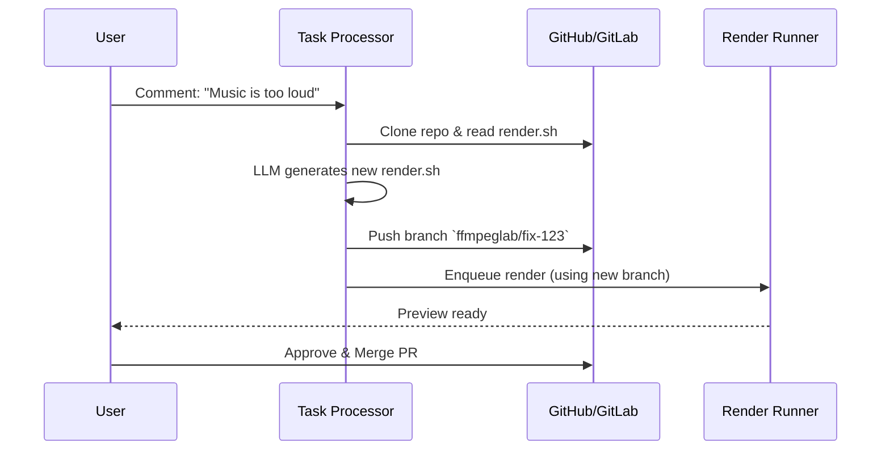

<div align="center">
  # FFmpegLab
  
  **Open Source FFmpeg API, Coding Agent & Render Marketplace.**

  [](https://opensource.org/licenses/MIT)
  [](https://github.com/ffmpeglab/server)
  
  *FFmpegLab is the framework for securing and running ffmpeg. Query your entire media catalog via SQL/API, define complex filter graphs with JSON, and run FFmpeg renders wrapped in the `bubblewrap` command line framework.*
  
  PostgreSQL • Supabase • S3 • Whisper AI • FFmpeg • Self-hostable • Open-source • pgmq • bubblewrap
</div>

---

## What is FFmpegLab?

Most media APIs are black boxes: you send a command, you get a file, and you have no idea what happened in between. FFmpegLab is different. It is a **Git-native video processing platform** built around three pillars:

1. **The API**: A robust, scalable REST API for queuing and executing FFmpeg renders.
2. **The Coding Agent**: An AI assistant that edits your FFmpeg scripts directly in your git repo based on timeline comments.
3. **The Marketplace**: A public catalogue of renders that anyone can fork and re-render.

Whether you are running a massive SaaS or just automating your own media pipeline, FFmpegLab gives you the primitives to do it securely and reproducibly.

---

## The Three Pillars

### 1. The FFmpeg API
Programmable, secure, and scalable rendering.
- **SQL/API Media Catalogue**: Query your entire media library via PostgreSQL or REST.
- **JSON Filter Graphs**: Define complex FFmpeg filter graphs in JSON, no command-line escaping required.
- **Zero-Trust Sandboxing**: Every render executes inside `bubblewrap` (`bwrap`), stripping network access, dropping capabilities, and strictly isolating file system access.
- **Scalable Runners**: Distribute rendering across multiple worker nodes using `pgmq` (PostgreSQL Message Queue).

### 2. The Coding Agent
"Figma for Video" — but backed by real code.
- Leave a comment on the timeline (e.g., *"Music is too loud at 0:08"*).
- The agent reads your project's `render.sh` from your connected Git repo.
- It prompts an LLM to rewrite the script, commits the change to a new branch, and triggers a preview render.
- **You own the code**: Approve the preview, and the agent opens a Pull Request. No proprietary JSON lock-in; every timeline change is a git commit.

### 3. The Render Marketplace
Community-driven reproducibility.
- Publish your approved renders to the public marketplace.
- Browse and search for pipelines, transitions, and effects.
- Fork any public render to your own account — the entire `render.sh` and project structure is cloned instantly.

---

## Architecture

FFmpegLab separates the API from the execution workers. The API handles auth, DB, and queues, while stateless runners execute tasks.

```text
+-------------------------------------------------------------+
|                     Webapp (Browser IDE)                    |
+-----------------------------+-------------------------------+
                              | REST + WebSocket
                              v
+-------------------------------------------------------------+
|                     FFmpegLab API Server                    |
|  +----------+  +----------+  +----------+  +-------------+  |
|  | Renders  |  | Roles    |  |  Items   |  |    Agent    |  |
|  |   API    |  |   API    |  |   API    |  |  Tasks API  |  |
|  +----+-----+  +----+-----+  +----+-----+  +------+------+  |
|       |             |             |               |         |
|       v             v             v               v         |
|  +------------------------------------------------------+   |
|  |     PostgreSQL + pgmq                                |   |
|  |     render . log . task queues                       |   |
|  +------------------------------------------------------+   |
+-------------------------------------------------------------+
       |             |             |               |         
       v             v             v               v         
+------------+  +----------+  +----------+  +-------------+   
|   Render   |  |   Logs   |  | Supabase |  |    Task     |   
|   Runner   |  |  Runner  |  | (Storage)|  |  Processor  |   
+-----+------+  +----------+  +----------+  +------+------+   
      |                                            |          
      v                                            v          
  bwrap+ffmpeg+git                               LLM + Git
  (isolated rendering)                    (makes pull request to repo)
```

- **Render Runner**: Spawns `bwrap` + `ffmpeg`. Needs `CAP_SYS_ADMIN` for namespace isolation. Reads directly from the cloned git repo.
- **Task Processor**: Clones the repo, calls the LLM (via `opentenant-platform`), pushes the new branch, and enqueues a render.
- **Logs Runner**: Consumes FFmpeg `stderr`/`stdout` chunks and writes them to PostgreSQL for real-time UI updates.

---

## Git-Native Workflow

FFmpegLab can store your FFmpeg commands in **your Git repo**.



### Securing the execution
When the render runner clones your repo, it doesn't just run whatever is inside. It executes it inside `bubblewrap`:
- `--unshare-all`: No network access.
- `--die-with-parent`: Kills the process if the runner dies.
- `--ro-bind /usr /usr`: Read-only system libraries.
- `--bind scratchDir scratchDir`: The *only* writable directory is the render scratch space.

---

## Quick Start

### 1. Try the Browser IDE
No install required. Open **[webapp.ffmpeglab.com/webapp](https://webapp.ffmpeglab.com/webapp)** to start editing in your browser using WebAssembly.

### 2. Self-Host the Stack
Deploy the API, self-hosted Supabase, and runners using Docker Compose. 

```yaml
networks:
  isolated:
    internal: true
  public:

services:
  api:
    image: ffmpeglab/server
    ports: ["3000:3000"]
    environment:
      - DB_HOST=${DB_HOST}
      - DB_NAME=${DB_NAME}
      - SUPABASE_URL=${SUPABASE_URL}
      - SUPABASE_SECRET_KEY=${SUPABASE_SECRET_KEY}
    networks:
      - isolated
      - public
  
  render-runner:
    image: ffmpeglab/server
    deploy:
      replicas: 2
    security_opt:
      - seccomp:unconfined
      - apparmor:unconfined
    cap_add:
      - SYS_ADMIN # Required for bubblewrap sandboxing
    environment:
      - IS_RENDER_RUNNER=true
      - GIT_HTTPS_TOKEN=${GIT_HTTPS_TOKEN}
      - PLATFORM_HOST=${PLATFORM_HOST}
    networks:
      - isolated
      - public
      
  task-runner:
    image: ffmpeglab/server
    environment:
      - IS_TASK_RUNNER=true
      - OTARI_API_KEY=${OTARI_API_KEY}
      - GIT_HTTPS_TOKEN=${GIT_HTTPS_TOKEN}
      - PLATFORM_HOST=${PLATFORM_HOST}
    networks:
      - isolated
      - public

  logs-runner:
    image: ffmpeglab/server
    environment:
      - IS_LOGS_RUNNER=true
    networks:
      - isolated
```

### 3. Connect a Repo
1. Create a `render.sh` in your GitHub/GitLab repo.
2. Use `$MEDIA_1`, `$MEDIA_2`, and `$OUTPUT_PATH` as placeholders.
3. Connect the repo in the FFmpegLab UI.

---

## Features

- **Visual Editor**: Drag-and-drop timeline with live WebAssembly previews.
- **AI Agent**: Chat with your timeline to adjust volumes, add transitions, or modify filters.
- **Hardware Acceleration**: Auto-detects NVENC, QSV, and VAAPI inside the runner.
- **YAML to SQL Transpiler**: Define Supabase triggers to auto-generate thumbnails or transcode videos on upload.
- **TypeScript SDK**: Fully typed API client for integration into your apps.

---

## Documentation & Community

- **[Agent Setup Guide](https://ffmpeglab.com/articles/agent-first-setup-ffmpeglab-server.html)** — How to connect your repo and configure the AI agent.
- **[SQL Pipeline Templates](https://ffmpeglab.com/articles/ultimate-video-onboarding-pipeline-sql-triggers-supabase.html)** — Ready-to-use Postgres triggers for media processing.
- **[Debugging FFmpeg](https://www.ffmpeglab.com/articles/ffmpeg-debugging-troubleshooting-guide.html)** — Master `-loglevel` and filtergraph errors.

**Contributing**
We welcome contributions! Check out the [webapp](https://github.com/ffmpeglab/webapp) and [server](https://github.com/ffmpeglab/server) repositories to get started.

## License

MIT License. See [LICENSE](LICENSE) for details.
